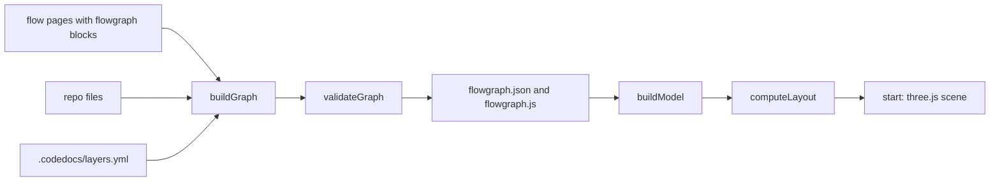

# Flow view

## Responsibility

Show where the documented flows run through the code, and where nothing documented runs. It
has two halves joined by one file, flowgraph.json:

- the **graph builder** in the tool (`codedocs flows`), which turns `flowgraph` blocks on flow
  pages plus a scan of the repo into a validated graph of layers, districts, units and flows;
- the **view** (`tool/assets/flowview.html` and lib/flowview.js, built from
  `flowview/src/main.ts`), a three.js scene that lays that graph out and animates it. It knows nothing about markdown or the docs model.

The judgement (which hops a flow makes, what they're called, which touch the database) belongs
to the agent and lives in the blocks. Everything mechanical is here.

## How it works



The contract is `schema/flowgraph.v1.json`. The Go side never writes a graph that breaks it:
`tool/flowgraph.go#validateGraph` checks the same rules in code, and
`tool/flowgraph_test.go#TestSchemaAndValidatorAgree` feeds both the schema and the validator a
set of broken graphs to keep them in step. The view checks references again as it loads
(`flowview/src/graph.ts#buildModel`), so a hand-edited file fails with a message rather than a
blank screen.

The graph is written next to the docs as JSON and as flowgraph.js (`window.__FLOWGRAPH__ = …`),
because a page opened from disk can load a script but can't fetch a file. `serve` doesn't use
the written copy at all: it builds the graph on request, cached for a few seconds, so editing a
block shows up on reload. `export` builds it once into the site.

## Parts

### Blocks

`tool/flows.go#flowBlocks` reads every ```` ```flowgraph ```` fence on a page, one hop per line
(`tool/flows.go#parseUnitRef` reads the unit: a code ref, or a keyword such as `store` or
`route`). Errors carry the page line, so `codedocs flows` points at the exact line to fix.
The docs viewer renders the same block as a numbered list
(`tool/assets/index.html#flowgraphHtml`), with its own lighter parser; it only displays.

### Units and layers

`tool/flows.go#extractUnits` lists the units of a file with per-language patterns: exported
functions, classes and their methods, and route handlers (Express style, Go `HandleFunc`,
Python decorators, Laravel routes), each with its line span. A step resolves to the unit whose
symbol matches, else a unique method of that name, else whatever span `symbolSpan` finds, so a
private function a block names still becomes a unit.

Each file gets a layer from `.codedocs/layers.yml` (`tool/flows.go#loadLayerRules`, a small
hand-rolled YAML reader), else its component's `layer` frontmatter, else
`tool/flows.go#heuristicLayer` (file-name endings like `.controller`, then the deepest folder
name that says a tier, then extension). Files nothing places go on the services layer and are
reported. Districts are the owning component, or the folder. Above 2000 units the graph drops
to one unit per file so the view stays fast.

### Reach

A flow names the hops that matter, not every helper they call, so "on no flow" overstates what
is undocumented. `tool/reach.go#computeReach` runs at the end of `buildGraph` (function
granularity only) and marks the code a flow runs without naming: `reached: {flow, via}` on the
unit. `tool/reach.go#callEdges` finds calls in each unit's own lines (a nested method's lines
count as the method's) as a name followed by `(`, matched to units of that name in files the
caller can see (`tool/reach.go#sourceVisibility`: its own file, its Go package, the files it
imports, by the code panel's import resolution). `tool/reach.go#reachFrom` walks those edges
breadth first from each flow's steps, in flow order, so a unit is credited to the first flow that
reaches it and to the unit that called it.

It's approximate in both directions, like [callers](code-intelligence.md): a same-named function
in a visible file can be matched wrongly, and a function only passed as a value (an event
handler, a callback) isn't followed. The walk stops at entry handlers
(`tool/reach.go#entryTargets`: what a CLI `case` line or an event listener hands off to),
because otherwise one flow that names `main` or a page's `init` would reach every command and
every click handler; those start flows of their own. The view dims reached units instead of
showing them as gaps, and the coverage pill adds "· N% reached".

### The command

`tool/flows_cmd.go#cmdFlows` builds, validates, prints a summary and writes the files
(`tool/flows_cmd.go#writeFlowView`), or prints the problems and writes nothing.
`tool/flows_cmd.go#cmdFlowsScan` (`--scan`) is the agent's survey: unclassified files, flow
pages and which blocks are stale since the last written graph's commit, routes and other entry
points, side-effect candidates credited to the smallest unit containing each line, **entry
points no flow starts at or runs** (a route, CLI command or event listener whose handler is
neither a step nor reached: the list of flows still to write), and the units nothing names or
reaches, by district, with their names (undocumented paths, or dead code). The summary prints
both figures: units on a flow, and units on or reached from one.

### Layout

`flowview/src/layout.ts#computeLayout` is deterministic: the same graph always gives the same
picture. Districts that share a feature name across layers (`featureKey` strips tier words, so
`users`, `UserService` and `users-api` meet) get one slot, stacked vertically, so a flow drops
straight down through its feature. The slots are packed with a squarified treemap
(`flowview/src/layout.ts#treemap`) weighted by unit count, and the slabs grow with the code.
Units sit in their district on a seeded jitter (`flowview/src/graph.ts#rng`); outside services
float beside the service layer.

### Scene

`flowview/src/app.ts#start` builds the scene: instanced meshes for units (one draw call per
shape), all flow tubes merged into one geometry in flow order so the light-up can reveal them
with a draw range, additive pulses, and a pool of at most 40 HTML labels. It owns the modes
(light-up, one flow, gaps; there's deliberately no "all flows" mode, since every flow at once
tangles as a project grows, so nothing runs until a flow is picked), the camera presets, picking with enlarged invisible hit
spheres for touch, the unit card and the deep-link hash. `flowview/src/bloom.ts#MockupBloomPass`
puts back the glow of the three.js version the mockup was made in. Without WebGL,
`flowview/src/fallback.ts#renderFallback` draws a static SVG side view.

### The 2D view

The 2D view (the **2D view** button, `#focus-<id>`; the code calls it Focus) lays one flow out
flat, as a straight line from top to bottom. Every unit has a home on its slab (`pos`) and a
place where it's drawn (`show`); `setFocus` gives the flow's units a place in one column
(`focusLayout`: a row per unit, in the order the flow first reaches it) and the frame loop eases
them there over 1.2 s, on the same curve as the camera. Layers become dividers across the column
with the layer's name, wherever the flow moves to another layer. A hop that isn't to the next row
down (a return to an earlier unit, or a skip past rows) bows out to the right
(`buildPath`'s `jump`) instead of running back over the line. Everything else fades: other units
shrink to nothing and stop being pickable, and the slabs, district outlines and dust go dim. The
camera faces the column square on and can't orbit, only pan and zoom.

The flow's tube and branch stubs are rebuilt from where its units are drawn every frame they
move, so the line of light travels with them; other flows sharing those units catch up once the
move ends. The framing (`focusPreset`) works in pixels, because labels are HTML of a fixed size:
on a wide screen the column sits in the middle with step labels to its left and names to its
right; on a narrow one it goes to the left with everything to its right. A flow too long to fit
keeps its rows at least about 34 px apart and starts at its top.

## Interfaces

- Reads flow pages, component frontmatter, `.codedocs/layers.yml` and the repo's files; writes
  flowgraph.json, flowgraph.js, flowview.html, flowview.css and lib/flowview.js into
  the docs folder.
- The [server](server.md) serves /flowgraph.json and /flowgraph.js live; the
  [viewer](viewer.md) shows flowview.html in a frame. The frame talks back with
  `postMessage` (`{codedocs: 1, type: 'open-code' | 'open-page' | 'hash'}`) so "Open in code
  viewer" opens the code panel and the docs URL follows the view's deep link.

## Watch out for

- `tool/assets/lib/flowview.js.gz` is built from `flowview/src`, not edited. Run
  `npm run build` in `flowview/` and commit the result; CI fails if it doesn't match the source.
- Change the schema, `tool/flowgraph.go#validateGraph` and `flowview/src/types.ts` together.
  The agreement test catches the first two drifting, not the third.
- three.js changed its bloom since r128: the mockup's settings wash out to white in the current
  version. Keep `MockupBloomPass` (and its strength scale) if you upgrade three.
- flowview.html is never written or served as it is in `tool/assets`: every path that hands it
  out (serve, export, `flows`, install-viewer) goes through `tool/flows_cmd.go#flowviewPage`,
  which addresses its script and stylesheet by a hash of their contents (`lib/flowview.js?v=…`).
  The server caches `/lib/` for a day but never the page, so without the hash a browser pairs a
  new page with yesterday's script after an upgrade (buttons the new script enables stay grey).
  `tool/flowgraph_test.go#TestFlowviewPageIsVersioned` fails if the tags in the page change shape.
- Labels are HTML over the canvas, so every visible label is a DOM element moved each frame.
  The cap of 40 is what keeps 2000-unit graphs smooth.
