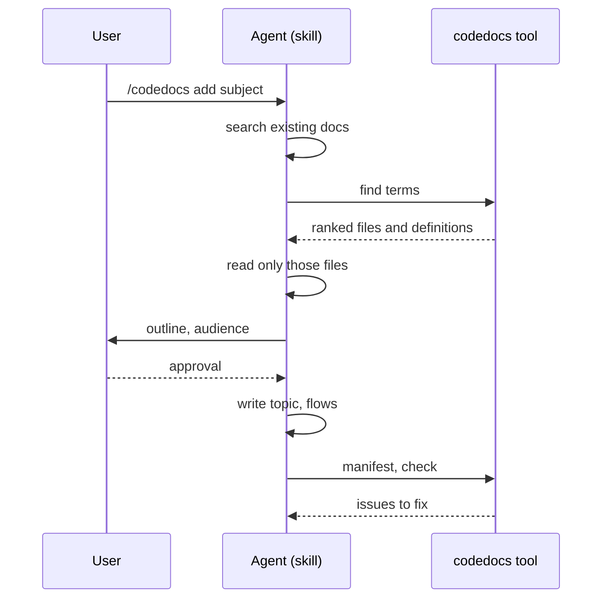

# Documenting a chosen subject

## In short

The user runs `/codedocs add payments` (or any noun phrase). The agent checks what the docs
already say, then asks the tool where the subject lives instead of searching the repo itself,
and reads only the files at the top of that list. It proposes an outline and waits, then writes
a topic page first and new flows after it, links the topic in, and runs `manifest` and `check`.
A statement of fact instead of a subject is an insight and takes a different path through the
same guide, recorded as the user's own words.



## Step by step

### 1. Dispatch and kind

`skills/codedocs/SKILL.md` maps `add` to `skills/codedocs/reference/add.md`, which first sorts
the request: a noun phrase is a subject, a statement is an insight. If there are no docs yet it
stops and suggests `/codedocs init`.

### 2. Scope with find

The agent picks two to five terms (the subject, synonyms, names the code is likely to use) and
runs `codedocs find`. `tool/find.go#cmdFind` lists files that match by path, by content and by
definition names, ranked so the heaviest hits come first. The guide tells the agent not to grep
the repo itself, which keeps the cost of scoping small.

### 3. Read what matters

The agent reads the entry points and the top of the list. Past roughly 15 relevant files it
sends read-only subagents per area and keeps their summaries, as `init` does.

### 4. Outline

It asks who the page is for (`admin`, `developer`, `both`) and shows the topic, new pages,
updates to existing pages, expected glossary terms and gotchas, and questions only the user can
answer. Nothing is written until the user confirms; anything they add here is treated as an
insight.

### 5. Write and link

The topic page comes first, then flows for the journeys the subject adds, then a component only
if no existing one covers the code. Existing pages get small additions, never rewrites, and
locked pages are skipped. The topic is added to the overview's Topics section.

### 6. Check

`tool/cmds.go#cmdManifest` rebuilds the manifest and `tool/cmds.go#cmdCheck` reports bad refs
and links; the agent fixes them and tells the user what was added and what is still open.

## Flow graph

```flowgraph
`skills/codedocs/SKILL.md` | /codedocs add
`skills/codedocs/reference/add.md` | Follow the add guide
branch | A fact, not a subject: record an insight
`tool/find.go#cmdFind` | Find the subject's code
branch | Large subject: subagents per area
`tool/cmds.go#cmdManifest` | Build the manifest | disk-write
`tool/cmds.go#cmdCheck` | Check refs and links
branch | Issues: fix and check again
```

## When it goes wrong

- `find` returns nothing useful: the terms don't match the code's names. Try synonyms, or ask the
  user what the code calls it.
- The subject is already half-documented: the guide tells the agent to search the docs first and
  extend rather than duplicate.
- `check` reports a ref that doesn't exist: the agent wrote a symbol it hadn't confirmed. Fix the
  ref; don't pad.

## Things to know before changing it

The approval step is the guard against writing a large topic around the wrong code. Insights
(`> [!INSIGHT]` callouts) and `status: stated` decisions are the user's; any command that
rewrites pages must carry them over unchanged.
