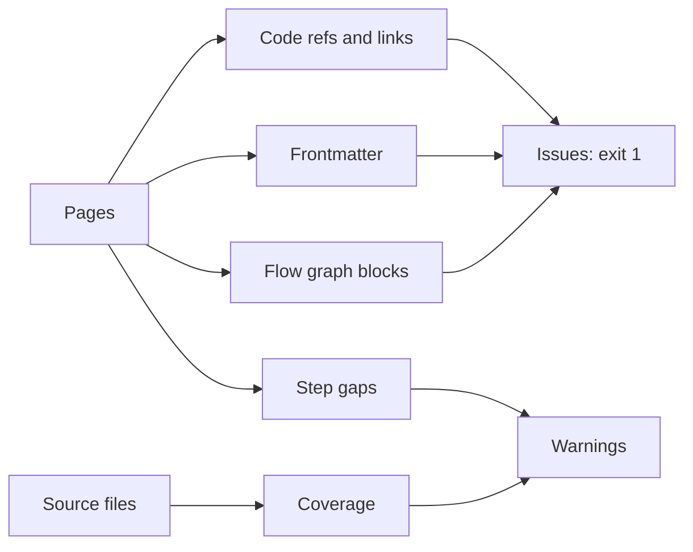

# Checking the docs

## In short

`codedocs check` loads every page and tests it against the repo as it is now: do the code refs
point at real files and symbols, do page links land on pages, do the frontmatter names exist, and
do the flow graph blocks resolve. Those findings are issues and make the command exit with
status 1. Flow steps that name no function, source files no component claims, and pages written
under older guidance are reported but never fail the run. `--json` prints the same findings for
the skill to read.



## Step by step

### 1. Load pages and the repo's view of them

`tool/cmds.go#cmdCheck` finds the docs folder and config, then `tool/pages.go#loadPages` reads
every page. It builds the set of page files and of component slugs to check links and
`components:` lists against.

### 2. Code refs

`tool/pages.go#extractRefs` pulls every code-ref-shaped inline code span out of each body. A
ref is `missing-file` if the path doesn't exist, `line-out-of-range` if a `:N` or `:N-M` is past
the file's end, and `missing-symbol` if `tool/pages.go#resolveSymbol` finds no declaration for
`file#Symbol`. Each issue carries the page and the line in the page.

### 3. Links and frontmatter

`tool/pages.go#extractLinks` returns the page's markdown links; each is resolved relative to the
page's own folder and must be another page, else `broken-link`. A name in `components:` that
isn't a component slug is `unknown-component`, and a component page with no `paths` is
`component-without-paths`.

### 4. Flow step gaps

For flow pages, `tool/cmds.go#flowStepGaps` looks at each `###` step under "Step by step". A step
with no code ref, or only refs to whole code files longer than 50 lines, becomes a
`step-without-symbol` warning, because the flow's code view would have nothing to show there.

### 5. Flow graph blocks

If any page has a flowgraph block, `tool/flows.go#buildGraph` builds the whole graph. Its
problems (a block that doesn't parse, a step whose unit can't be resolved, a duplicate flow id),
layer-rules mistakes and graph validation errors are all issues of type `flowgraph`.

### 6. Coverage and age

`tool/files.go#sourceFiles` lists the repo's source files, minus the config's `ignore` and the
docs folder. Code files not matched by any component's `paths` are counted as uncovered and
summarised by folder (the top twelve). The check is skipped when there are no components.
Finally, `tool/cmds.go#guidanceVersion` and `tool/util.go#semverCmp` mark pages whose
`generated_with` is older than the current guidance as outdated.

### 7. Report

Back in `tool/cmds.go#cmdCheck`, text output prints issues, then warnings, coverage and outdated pages; `--json` prints one
object with `ok`, `issues`, `warnings`, `outdated` and `uncovered` (with at most 50 sample
files). The process exits 1 only if there are issues.

## Flow graph

```flowgraph
`tool/cmds.go#cmdCheck` | Run the checks
`tool/pages.go#loadPages` | Load every page
`tool/pages.go#extractRefs` | Collect code refs
`tool/pages.go#resolveSymbol` | Does the symbol exist?
branch | Missing file, line or symbol: an issue
`tool/pages.go#extractLinks` | Collect page links
`tool/cmds.go#flowStepGaps` | Find steps with no function
`tool/flows.go#buildGraph` | Resolve flow graph blocks
`tool/files.go#sourceFiles` | List the repo's code
`tool/cmds.go#guidanceVersion` | Find outdated pages
branch | Any issue: exit 1
```

## When it goes wrong

- A ref reported `missing-symbol` after a rename: the page needs the new name. The check doesn't
  suggest one.
- `broken-link` on a link to a page you just created: the link must be to the `.md` file,
  relative to the linking page's folder.
- `flowgraph` issues name the page and line of the offending step; fix the ref or the unit label.
- A long "Coverage" list is a hint, not an error: add paths to a component or add a component.

## Things to know before changing it

- Issues and warnings are different lists on purpose: adding to `issues` makes CI fail. New
  advisory checks belong in `warnings` or their own report section.
- `flowStepGaps` mirrors the viewer's step parsing (`flowSteps` in the viewer); change them
  together or the check and the code view will disagree.
- Coverage only counts files with a known code extension; docs, config and assets never show as
  uncovered.
- The check reads the working tree, not git, so it reports on uncommitted edits too.
