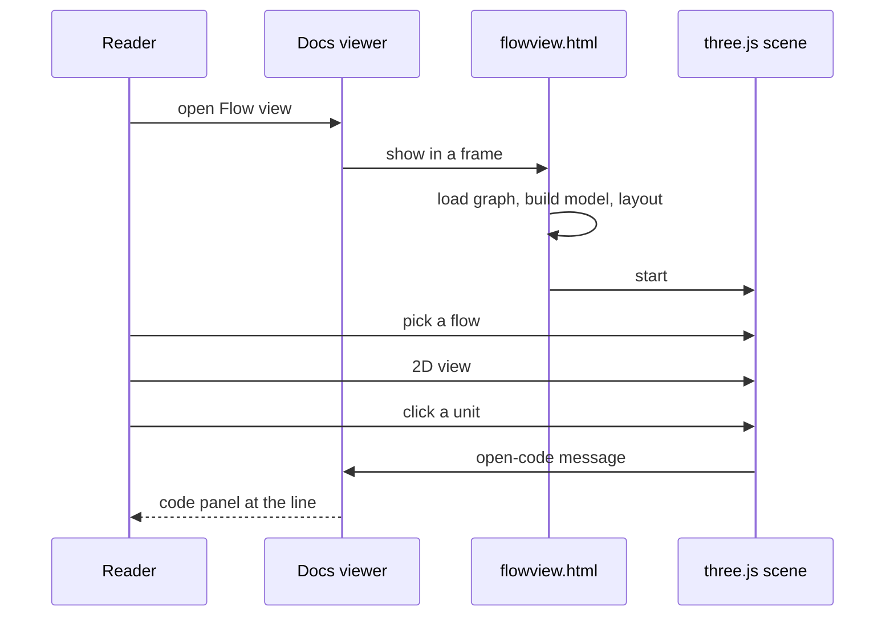

# Exploring the flow view

## In short

The reader opens Flow view in the docs viewer, which shows flowview.html in a frame. The page
loads the graph, builds a model and a layout, and starts the three.js scene, but nothing runs
yet: there is no "all flows" mode, so the reader picks a flow first. From there they can flatten
it into the 2D view, click a unit to read its card, and send the unit's file back to the docs
viewer's code panel. A browser without WebGL gets a static SVG side view instead.
See the [flow view](../components/flow-view.md) for how the pieces are built.



## Step by step

### 1. Open it

`tool/assets/index.html#showFlowView` puts `flowview.html?embed` in an iframe (adding `code=1`
when the viewer has a server to fetch files from, and any `#flow-<id>` deep link). The page is
served by the /flowview.html route, which hands out the version-stamped page.

### 2. Load, model, layout

`flowview/src/main.ts#main` calls `flowview/src/main.ts#loadGraph`, which uses a `?src=` file if
given, else the script-embedded `window.__FLOWGRAPH__`, else fetches flowgraph.json (the
server builds it live; see [building the graph](flow-graph.md)). A missing graph shows a message
telling the reader to run `/codedocs flows`. `flowview/src/graph.ts#buildModel` re-checks every
reference, so a hand-edited file fails with a message rather than a blank screen.
`flowview/src/layout.ts#computeLayout` then places layers, districts and units
deterministically.

### 3. Start the scene

`flowview/src/app.ts#start` builds the scene and the controls. The initial picture is the
glass layers with every unit dimmed; no flow runs. If it throws, `main` falls back to the SVG
view with the error as the reason.

### 4. Pick a flow

Choosing a flow (the `selectFlow` function inside `flowview/src/app.ts#start`, from the
dropdown at the top or a unit card's flow buttons) fades everything else and animates the flow's line of light
through its units, with branches as short stubs. The hash follows, so the URL is a link to that
flow. The dropdown is a native select so it holds any number of flows and works with a
keyboard, a screen reader and a phone's own picker; its first option, "Choose a flow…", lets the
flow go again. A dot beside it takes the chosen flow's colour.

### 5. The 2D view

The 2D view button (`setFocus` and `focusLayout`, also inside `flowview/src/app.ts#start`) moves
the flow's units into one straight column, one row per unit in the order the flow first reaches
it, with the layers as dividers. Everything else fades and can't be picked. The camera can pan
and zoom but not orbit. A hop that doesn't go to the next row bows out to the right.

### 6. Inspect a unit

Clicking a unit calls `showCard` (inside `flowview/src/app.ts#start`). The card shows the layer
and district, then one of three things: the flows the unit is on (as buttons that switch to
them); for a unit on no flow that a flow calls, the unit it is called from, marked as found by
name and so approximate; or, for neither, a note that no documented flow names or calls it,
which means an undocumented path or dead code.

### 7. Open in code viewer

The card's link, when embedded with a code panel, posts `{codedocs: 1, type: 'open-code', file,
line, end}` to the parent instead of navigating (the `openCode` hook in `flowview/src/main.ts`).
The docs viewer's `message` listener in `tool/assets/index.html` calls `showCode`, which opens
the panel at that line. Standalone, the link goes to the file path or the repo's web URL.

## Flow graph

```flowgraph
`tool/assets/index.html#showFlowView` | Open Flow view
route ANY /flowview.html | Serve the page
`flowview/src/main.ts#main` | Page starts up
`flowview/src/main.ts#loadGraph` | Load the graph
`flowview/src/graph.ts#buildModel` | Check and build the model
`flowview/src/layout.ts#computeLayout` | Lay out layers and units
branch | No WebGL: draw the SVG side view
`flowview/src/app.ts#start` | Start the 3D scene
`tool/assets/index.html#showCode` | Open code panel at the line
```

## When it goes wrong

(Without WebGL, `main` calls `flowview/src/fallback.ts#renderFallback` instead of `start`.)

- "No flow graph yet": nothing has been written and no flow page has a block. Run
  `/codedocs flows`, or add a block.
- "This browser can't draw 3D (no WebGL)" or "The 3D view couldn't start": the SVG side view
  shows the layers and flows without animation. Adding `?nowebgl` to the URL forces it.
- "Open in code viewer" opens a new tab instead of the panel: the page isn't embedded, or the
  docs aren't served (a static export has no file API).

## Things to know before changing it

- The functions you'd look for (`selectFlow`, `setFocus`, `showCard`) are closures inside
  `start`, so they are not units in the flow graph and share one ref.
- The message shape (`codedocs: 1` plus `type`) is a contract between `flowview/src/main.ts` and the viewer's
  listener; change both together.
