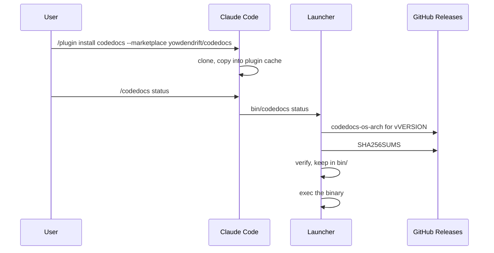

# Installing and first run

## In short

Installing the plugin copies this repository into Claude Code's plugin cache, without binaries.
The first `/codedocs` command runs the launcher, which finds no binary, downloads the one for this
machine and version from GitHub Releases, checks it against `SHA256SUMS`, keeps it in the skill's
`bin/` folder and runs it. Every later command finds it there and runs it straight away.

## Step by step

### 1. Install

Claude Code reads `.claude-plugin/marketplace.json`, which lists one plugin whose source is the
repository root, and `.claude-plugin/plugin.json` for its name and version. It copies the repo
into its cache under that version and loads `skills/codedocs/`. The skill is invoked as
`/codedocs`, or `/codedocs:codedocs` if another command has that name.

### 2. The skill calls the launcher

`skills/codedocs/SKILL.md` always runs `<skill>/bin/codedocs`, never the binary directly, so the
same instructions work on every platform.

### 3. Pick and fetch the binary

`skills/codedocs/bin/codedocs` maps `uname` to an asset name (`codedocs-darwin-arm64`,
`codedocs-windows-amd64.exe`…). If that file isn't beside it, it reads `skills/codedocs/VERSION`
and `skills/codedocs/REPO`, downloads the asset and `SHA256SUMS` from the release `v<VERSION>`,
and compares checksums. A mismatch, a missing asset or a failed download stops with a message
saying what to do. On success it keeps the binary in `bin/` and runs it.

### 4. The binary finds its skill

`tool/cmds.go#skillDir` resolves the binary's own path to find the skill folder beside it, which
is how `version --guidance` reads the installed guides' version.

## When it goes wrong

- "Release may still be building": the plugin was updated in the minutes between a version bump
  reaching `main` and the release workflow finishing. Try again shortly.
- Permission denied running the launcher on macOS or Linux: it lost its executable bit in git.
  CI guards against this.
- A sandboxed agent with no network can't download. Approve the download once, or build with
  `build.sh`.

## Things to know before changing it

The binary version is tied to `skills/codedocs/VERSION`, not to the plugin's cache folder, so a
new version means a new folder and a fresh download. Anything the user should keep across
updates (a saved default theme, for example) must live outside the skill folder.
