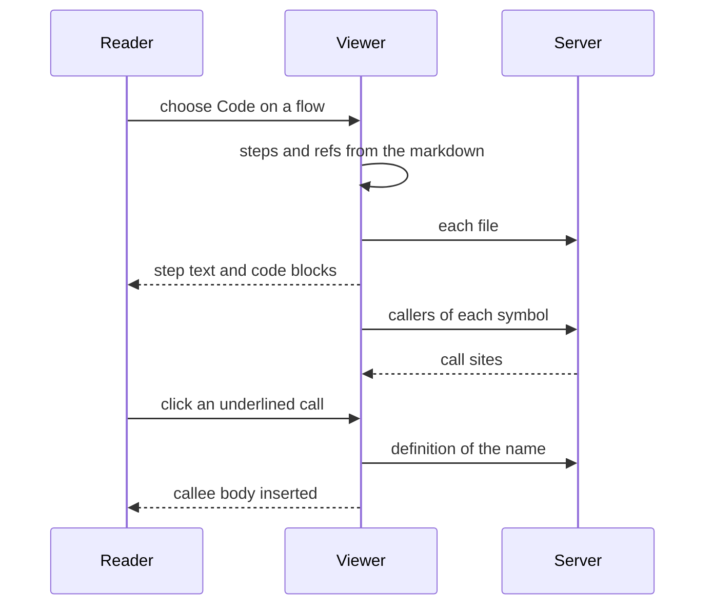

# Reading a flow as code

## In short

A flow page names the functions that do its work. The Code view turns that into one read: it takes
the steps from the page, finds the function bodies they name, and lays the code out under each
step. Calls inside that code are underlined; clicking one inserts the callee's body underneath, so
you can follow the flow downward without leaving the page. Each block also shows roughly how many
places call it, from a name-matching search on the server. The view needs a code panel, so it
exists when the docs are served or exported, not when the code can't be read.



## Step by step

### 1. The Code route

The Prose / Code toggle is two links: the page id, and `as-code/<id>`.
`tool/assets/index.html#route` sends the second to `tool/assets/index.html#showSlice`, which falls
back to the normal page when the page isn't a flow or there is no code panel. It then re-reads the
page markdown and builds one section per step.

### 2. Steps and refs come from the page

`tool/assets/index.html#flowSteps` reads the `###` headings under "Step by step" as the steps.
`tool/assets/index.html#refsIn` collects the code refs in each step's text, skipping fenced code
and ignoring inline code that isn't shaped like a path or symbol. A step with no ref gets a visible
"no code to show" note rather than being dropped, so a gap in the docs shows as a gap in the view. The same
step rule lives in Go (`tool/cmds.go#flowStepGaps`, behind `check`'s `step-without-symbol`
warning); the two must agree.

### 3. Which lines to show

`tool/assets/index.html#refRange` turns a ref into lines. A symbol uses the manifest's `spans`, the
first and last line worked out at build time by [code intelligence](../components/code-intelligence.md).
A `file:N-M` ref uses its own range; `file:N` uses the statement starting there; a whole-file ref
shows the first 40 lines with a button for the rest. A symbol the patterns couldn't find has no
body, and the block says so instead of guessing.

### 4. Fill each block

`tool/assets/index.html#blockShell` makes an empty block per ref, with its link, line range and an
"Also in" list of other pages naming the same symbol. `tool/assets/index.html#fillBlock` then loads
the file (each file is fetched and highlighted once, then shared by every block that uses it), draws
the lines and runs `tool/assets/index.html#markCalls`, which underlines each name followed by `(`.
Blocks fill independently, so a missing file spoils one block, not the page.

### 5. Count the callers

For symbol refs, `fillBlock` also asks `Code.callers`. `tool/assets/index.html#Code` hides where the
answer comes from: when served it calls `/api/callers`, and in an export it reads
code/callers.json. On the server, `tool/callers.go#findCallers` looks only in files that can see the
symbol (its own file, its importers and, for Go, its package) for lines that look like `name(`,
skipping its own definition, comments and imports, and stops at 200. The button reads like
"≈12 calls in 3 files"; the ≈ is honest. It is a name match: two unrelated functions with the same
name count each other, and calls through an interface or callback are missed. Clicking it lists
the sites in the code panel.

### 6. Expand a call

Clicking an underlined name runs `tool/assets/index.html#expandCall`: ask `Code.definition`, and if
there is exactly one match with a body of at most 400 lines, insert it under the calling line. The
inserted body has its own calls underlined, so you can go several levels down. Clicking the same
name again, or the fold button, removes it. Several matches open a list to choose from; no match
says so (often it is a library); a larger body opens the code panel instead.

### 7. Ctrl/Cmd+click

The same click handler, in the document-level listener near the end of the Code view, treats
Ctrl or Cmd+click on any name in a block as "go to definition", even a name that isn't underlined:
`tool/assets/index.html#wordAt` reads the name under the pointer and `Code.definition` looks it
up. It goes to the code panel, the same journey as in [opening code](open-code.md).

## Flow graph

```flowgraph
`tool/assets/index.html#route` | Choose the Code view
`tool/assets/index.html#showSlice` | Build the steps
`tool/assets/index.html#flowSteps` | Find the steps
`tool/assets/index.html#refsIn` | Collect each step's refs
`tool/assets/index.html#refRange` | Work out the lines
`tool/assets/index.html#blockShell` | Lay out the blocks
`tool/assets/index.html#fillBlock` | Fill in the code
`tool/assets/index.html#markCalls` | Underline the calls
route ANY /api/callers | Ask who calls it
`tool/callers.go#findCallers` | Match the name nearby
branch | Static export: read callers.json
`tool/assets/index.html#expandCall` | Click a call to expand
```

## When it goes wrong

- "doesn't name a function or file": the step has no code ref. Add one to the flow page.
- "isn't defined in a way codedocs recognises": the symbol wasn't found as a definition, so there's
  no extent. Click the ref to open the file.
- A body stops early or runs long: extents come from bracket matching and are capped at 400 lines.
- "no calls found" may be wrong: callbacks, interfaces and re-exports are missed.
- In an export, a function reached only by expanding a call has no call count, since
  code/callers.json is precomputed for the symbols the docs name.

## Things to know before changing it

Served and static paths must return the same shapes, which is why the viewer only talks to
`Code`. Change `flowSteps` and `tool/cmds.go#flowStepGaps` together. `markCalls` is a text pattern
on the raw line, not a parser, so it can underline things that aren't calls, such as a type
conversion; and a call is wrapped by occurrence, not offset, because highlighting has already split
the line into spans.
