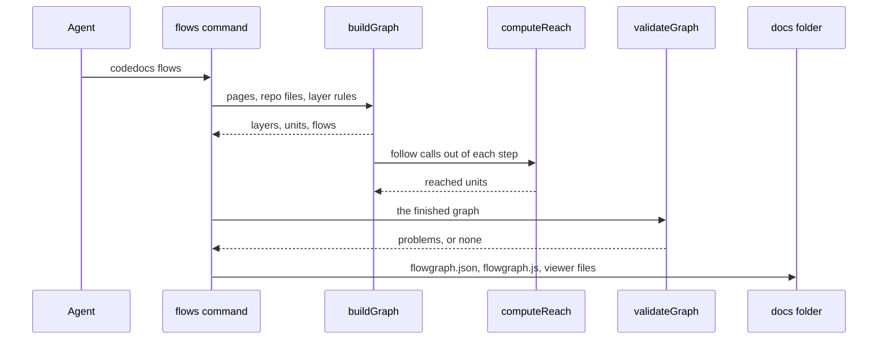

# Building the flow graph

## In short

`codedocs flows` reads the `flowgraph` block on every flow page, lists the units (functions,
methods, routes) of every source file, puts each file on a layer, and resolves each hop of each
flow to a unit. It then follows calls out of those units to find code a flow runs without
naming, checks the whole graph against the contract, and only then writes it next to the docs
with the viewer files. If anything is wrong it prints the problems and writes nothing. `serve`
builds the same graph on request instead of reading the written copy. The result is what the
[flow view](../components/flow-view.md) draws.



## Step by step

### 1. The command

`tool/flows_cmd.go#cmdFlows` finds the docs folder and builds the graph. With `--scan` it
hands over to `tool/flows_cmd.go#cmdFlowsScan` instead, which is the agent's survey before
writing blocks (unclassified files, stale blocks, entry points, side-effect candidates,
uncovered code). That branch builds the graph too, but only reports on it; it never writes.

### 2. Blocks, units and layers

`tool/flows.go#buildGraph` does the bulk of the work. It reads each flow page's block with
`tool/flows.go#flowBlocks`; each line's unit goes through `tool/flows.go#parseUnitRef` (a code
ref, or a keyword such as `route` or `store`), and errors keep the page line so they can be
fixed in place. It lists the repo's units with `tool/flows.go#extractUnits`, and gives each file a
layer from `tool/flows.go#loadLayerRules` (`.codedocs/layers.yml`), else its component's
`layer`, else `tool/flows.go#heuristicLayer`. Each step then resolves to the unit its symbol
names. [The flow view page](../components/flow-view.md#units-and-layers) has the matching rules.

### 3. Reach

A flow names the hops that matter, not every helper they call, so counting everything a flow
doesn't name as undocumented overstates the gap. `tool/reach.go#computeReach` follows calls out
of each step's unit, flow by flow in page order, breadth first, and marks every code unit it
finds with the first flow that reached it and the unit that called it. Those units are
**reached**: drawn dimmed, not counted as gaps.

The calls are found by name: a word followed by `(`, matched to units of that name in files
the caller can see (its own file, the rest of its Go package, the files it imports, via
`tool/reach.go#sourceVisibility`). It stops at units that are already on a flow, and at entry
handlers (`tool/reach.go#entryTargets`: what a CLI `case "name":` or an event listener hands
off to), because those start flows of their own even when a documented step such as `main`
dispatches to them. A function only passed as a value is not followed.

### 4. Validate

`tool/flowgraph.go#validateGraph` checks the finished graph against the rules in
`schema/flowgraph.v1.json`: references resolve, ids are unique, and so on.

### 5. Write

If there are no problems, `tool/flows_cmd.go#writeFlowView` writes flowgraph.json, flowgraph.js
(the same data as a script, so a page opened from disk can load it), flowview.html, flowview.css
and lib/flowview.js into the docs folder. `tool/flows_cmd.go#flowviewPage` stamps the page's
script and stylesheet tags with a hash of their contents, so a browser can't pair a new page
with a cached old script. The command ends with a summary: units on a flow, units reached, and
the percentage of the repo each covers.

### 6. On the server

`serve` doesn't read the written files. For /flowgraph.json (and /flowgraph.js) it calls
`tool/flows.go#graphCache.get`, which runs the same `buildGraph` and keeps the result for three
seconds, so editing a block shows up on reload. If no page has a block, the server falls back to
a flowgraph.json already in the docs folder.

## Flow graph

```flowgraph
`tool/flows_cmd.go#cmdFlows` | Run codedocs flows
branch | --scan: survey only, nothing written
`tool/flows.go#buildGraph` | Build the graph
`tool/flows.go#flowBlocks` | Read each flow's block
`tool/flows.go#extractUnits` | List the code's units
`tool/flows.go#heuristicLayer` | Place files on layers
`tool/reach.go#computeReach` | Mark code a flow calls
`tool/flowgraph.go#validateGraph` | Check the graph
branch | Problems: print them, write nothing
`tool/flows_cmd.go#writeFlowView` | Write graph and viewer | disk-write
route ANY /flowgraph.json | Server builds it live
```

## When it goes wrong

- "The flow graph has problems, so nothing was written": each line gives the page and line of a
  bad block (an unknown unit, a missing file, a symbol that doesn't exist) or a rule the finished
  graph broke. Fix the block and run it again. An old flowgraph.json stays as it was.
- A unit shows as reached when you expected a gap, or the other way round: calls are matched by
  name only, so two functions with the same name in visible files both count, and a callback
  passed as a value is missed. It is approximate by design.
- Files on Services that don't belong there: no rule placed them. Add them to
  `.codedocs/layers.yml`; `flows --scan` lists them.
- Above 2000 units the graph drops to one unit per file to keep the view fast. Pass
  `--granularity symbol` to force functions.

## Things to know before changing it

- `computeReach` runs inside `buildGraph`, before validation, so reach is part of the graph
  contract: change the schema, `validateGraph` and `flowview/src/types.ts` together.
- Flows are walked in order and the first one to reach a unit keeps it, so reordering flow pages
  can change which flow a reached unit is attributed to (inferred from the "first flow" rule in
  the code).
- The scan and the build share the entry-point patterns, so a change to what counts as an entry
  point changes both what `--scan` reports and where reach stops.
