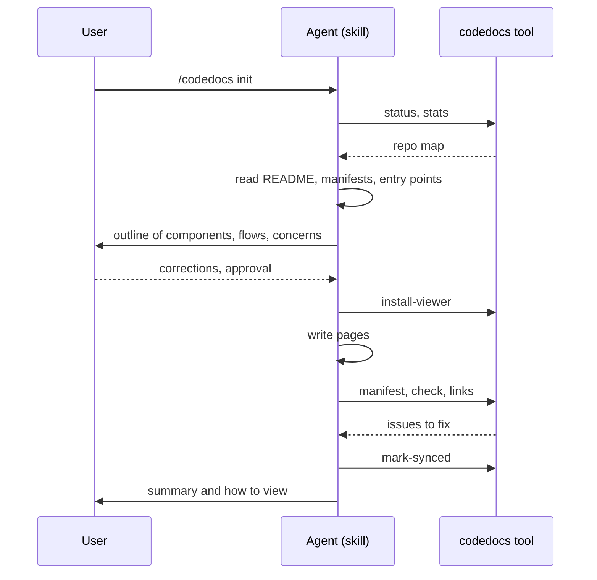

# Documenting a repo for the first time

## In short

The user runs `/codedocs init`. The agent asks the tool for a map of the repo instead of
listing files itself, reads the entry points, and proposes an outline of components, flows and
concerns. Only after the user approves it does it set up the docs folder and write pages,
structure first and overview last. The tool then rebuilds the manifest and checks every ref and
link, and the agent fixes what it reports.

## Step by step

### 1. Dispatch

`skills/codedocs/SKILL.md` maps `init` to `skills/codedocs/reference/init.md`, which tells the
agent to read the content model and writing guide before writing anything.

### 2. Existing docs?

`tool/cmds.go#cmdStatus` reports whether a docs folder exists. If it does, the agent offers
modes instead of starting over: refresh only pages written with older guidance, regenerate
everything (keeping locked pages, stated decisions and insights), selected pages, or just the
viewer.

### 3. Inventory

`tool/cmds.go#cmdStats` gives file and line counts by folder and extension, manifests, the
largest and most-changed files. The agent reads the README, the main manifests and the entry
points, then asks the user, in one message, anything it can't tell: what the project is for,
where the docs should live, which editor to link to, and what they already know is confusing.

### 4. Outline

For a small repo the agent follows imports itself. For a larger one it sends one read-only
subagent per area with a fixed brief and keeps only the summaries. It presents components (with
`paths`), flows, concerns, likely decisions and coverage, and waits. This is the cheapest point
for the user to say "those two are one thing".

### 5. Write

`tool/cmds.go#cmdInstallViewer` creates the folder, viewer and docs.config.json. The agent
writes components first (their slugs are what everything else links to), then flows, tracing each
through the real code, then concerns, decisions and gotchas, the glossary, and the overview last.
Each page is stamped with `generated_with` from `codedocs version --guidance`.

### 6. Check and finish

`tool/cmds.go#cmdManifest` and `tool/cmds.go#cmdCheck` catch wrong paths, renamed symbols,
broken links and code no component claims; the agent fixes each. `tool/links.go#cmdLinks` shows
whether the code panel's import links resolve, and the agent adds alias rules if not.
`tool/cmds.go#cmdMarkSynced` records the commit the docs describe.

## When it goes wrong

- `check` keeps failing on a symbol: the ref names something the resolver can't find (see
  `tool/pages.go#resolveSymbol`). Use a nearby symbol or a line ref.
- Coverage lists folders nobody owns: extend a component's `paths`, add `ignore` globs for
  generated or vendored code, or tell the user what's undocumented.

## Things to know before changing it

The order of writing is deliberate and stated in the guide; flows link to component slugs, so
writing flows first means fixing links later. The outline approval step is the main defence
against a wrong component map, which is expensive to fix after pages exist.
