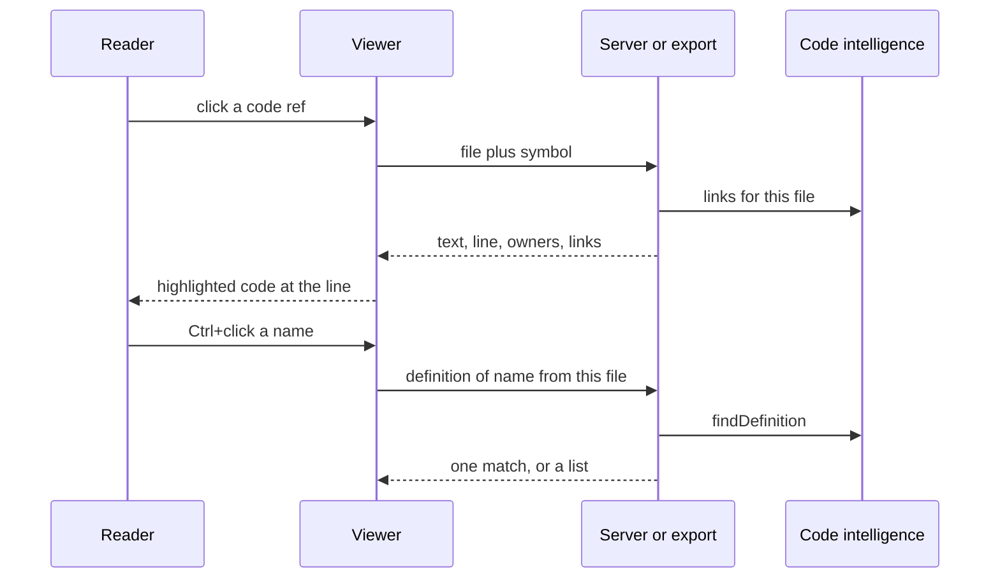

# Opening code from a page

## In short

A code ref in a page is already resolved to a line in the manifest, so the link knows where to
go before anything is fetched. Clicking it asks for the file (from the server, or from GitHub in a
static export), highlights it, and marks the imports that resolve as links. Following an import
opens that file at the imported name; Ctrl/Cmd+clicking any name asks for its definition.

## Step by step

### 1. The ref is resolved at build time

When the manifest is built, `tool/pages.go#buildManifest` resolves every `file#Symbol` ref with
`tool/pages.go#resolveSymbol` and stores the line in `symbols`. `tool/assets/index.html#refHtml`
turns the inline code into a link carrying file, line and symbol, and an editor URL (or a GitHub
URL in an export) for Ctrl+click.

### 2. Fetch the file

`tool/assets/index.html#showCode` calls `Code.file`. Served, that's `/api/file`, handled in
`tool/serve.go#cmdServe`: the path must be in the repo's file set, under 2 MB and not binary.
In an export, the file comes from `raw.githubusercontent.com` at the pinned commit, and the
links come from `code/meta/`.

### 3. Owners and links

The response says which components own the file (their `paths` match) and which pages mention
it, shown above the code. `tool/links.go#linksFor` supplies the import spans;
`tool/assets/index.html#applyLinks` wraps those exact text spans after highlighting, splitting
highlight spans where needed.

### 4. Follow an import

`tool/assets/index.html#followLink` opens the target file at the imported symbol, or, for a Go
import (a folder), lists the package's files.

### 5. Go to definition

`tool/assets/index.html#goToDefinition` reads the word under the pointer and asks
`Code.definition`. On the server that's `tool/defs.go#findDefinition`; in an export it's
`tool/assets/index.html#rankDefinitions` over code/defs.json, a tested copy of the server's
`tool/defs.go#rankDefinitions`. One match opens directly; several show a list to choose from.

## When it goes wrong

- "Not a source file in this repo": the file is ignored by git, binary, or over 2 MB.
- In an export, "Couldn't load … (404)": the pinned commit isn't on GitHub yet. `export` warns
  about this.
- No definition found: the name is declared in a way the patterns don't recognise, or comes from
  a dependency outside the repo.

## Things to know before changing it

The server and the static path must return the same shapes; `tool/assets/index.html#Code` is the
only place that knows the difference. Highlighting runs before links are applied, so link spans
are found by text and occurrence, not by character offsets in the source.
