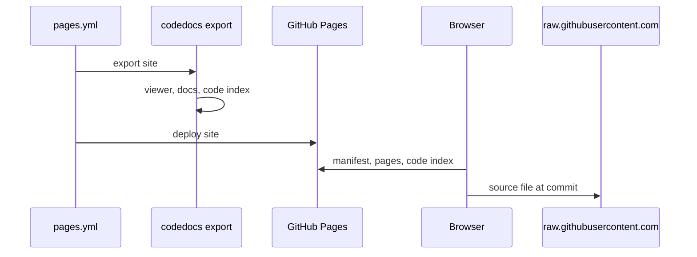

# Publishing the docs as a static site

## In short

`codedocs export <folder>` writes the viewer, the docs and a small `code/` index into a folder.
Uploaded anywhere, the viewer sees `"static": true` in the manifest and switches its code panel to
read files from `raw.githubusercontent.com` at the pinned commit, using the precomputed index for
file lists, import links and definitions. On this repo, `.github/workflows/pages.yml` does this on
every push to `main`, so the demo always matches the docs in the repo.

## Step by step

### 1. Export

`tool/export.go#cmdExport` writes the viewer and libraries from the binary, the repo's theme,
`content/`, and a manifest without machine paths. `tool/export.go#exportSource` picks the source
URL from the `origin` remote and pins it to the docs' `last_synced` commit, or `HEAD`.

### 2. Precompute what the server would answer

The file list goes into code/index.json, definitions into code/defs.json, and each file's
import links and resolved import targets into `code/meta/<path>.json`, all using the same
[code intelligence](../components/code-intelligence.md) as `serve`.

### 3. Deploy

The Pages workflow uploads the folder with GitHub's Pages actions. Any other static host works
the same way: it's plain files.

### 4. Read

`tool/assets/index.html#init` sees `static` in the manifest and loads code/index.json instead of
calling `/api/info`. From then on `tool/assets/index.html#Code` serves the code panel from GitHub
and the index, and "Open in editor" becomes "View on GitHub".

## When it goes wrong

- Code panel shows 404s: the pinned commit isn't pushed. `export` warns when that's the case.
- Line numbers look off: the docs were written against a different commit than the one shown.
  `export` notes when `last_synced` and the shown commit differ; run `/codedocs update`.

## Things to know before changing it

The static path duplicates the server's ranking and glob rules in JavaScript. Any change to
`tool/defs.go#findDefinition` or `tool/util.go#globRe` needs the same change in the viewer.
