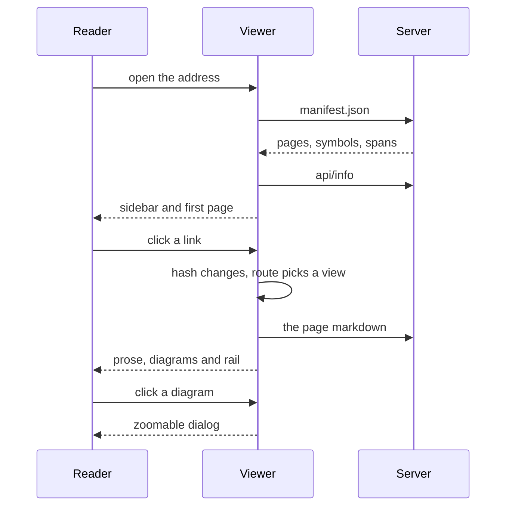

# Reading the docs in the viewer

## In short

The viewer is one HTML page that builds everything else in the browser. It loads the manifest (the
index of every page), asks the server whether a code panel is available, builds the sidebar and
then draws whatever the URL hash names. Each navigation is a hash change: the router picks a view
(a page, search, the map, the flow view), and a page is fetched as markdown and rendered with its
diagrams and right-hand rail. Opening code from a page is a separate journey, covered in
[opening code](open-code.md).



## Step by step

### 1. Load the manifest

`tool/assets/index.html#init` refuses to run from a `file://` address, loads the markdown renderer,
then fetches manifest.json with caching off. On a running server that request is answered live:
the /manifest.json handler in `tool/serve.go#cmdServe` calls `tool/pages.go#buildManifest` on every
load, so an edited page shows on refresh without rebuilding. In a static export the same file is a
plain file on disk, and the manifest says `static`. The manifest is the viewer's only index:
titles, headings, which components a flow visits, and the lines that code refs resolve to.

### 2. Decide whether there is code

Still in `tool/assets/index.html#init`, the viewer asks `api/info` (served) or code/index.json
(export). If either answers, a code panel exists; if neither does, refs open the editor instead and
flow pages get no Code view. Failing here is quiet on purpose: the docs still read fine without
code. Then `tool/assets/index.html#buildNav` builds the sidebar from the manifest's pages, grouped
by kind, and `init` starts listening for hash changes and runs the router once.

### 3. Route the hash

`tool/assets/index.html#route` is the whole router, and the URL hash is the only state. It checks in
a fixed order: `#/flowview…`, empty (home), `map`, `search/<terms>`, `as-code/<page>` and
otherwise a page id, each optionally followed by `::heading` to scroll to. Because the reader's
position is just a URL, back, forward and sharing links all work. It also closes the mobile
drawers, so any navigation leaves you looking at the page.

### 4. Show a page

`tool/assets/index.html#showPage` fetches the page's markdown and renders it with the renderers
installed by `tool/assets/index.html#setupMarked`. That setup turns a `mermaid` block into a
placeholder and a `flowgraph` block into a numbered list. Afterwards
`tool/assets/index.html#tagInferred` replaces each `(inferred)` marker with a visible tag, and
`tool/assets/index.html#renderDiagrams` loads mermaid on first use and draws the placeholders. A
diagram that fails to parse shows its error and source instead of vanishing.

### 5. The right-hand rail

`tool/assets/index.html#rail` builds the rail from the manifest alone: the page's headings, the
related pages (a component lists the flows through it, a flow lists its components), a link into the
flow view and the code it owns. For a component the code is a file tree.
`tool/assets/index.html#fillRailTree` fills it in afterwards from the server's real file list, and
quietly falls back to the path patterns if that fails. On a narrow screen the rail becomes a drawer;
a document-level click handler near the top of the script closes it when you follow a rail link or
click anywhere outside it.

### 6. Zoom a diagram

Clicking a rendered diagram runs a document-level handler that finds the `<svg>` and calls
`tool/assets/index.html#openDiagram`, which puts a clone of it in a dialog sized from its viewBox.
Wheel, drag, the buttons and `+`, `-`, `0` zoom, pan and fit; Escape, the close button or a click
on the backdrop run `tool/assets/index.html#closeDiagram`. Clicks on links inside a diagram, and on
diagrams that failed to render, are ignored.

### 7. Sidebar sections

Sidebar sections open one at a time: `tool/assets/index.html#openSection` closes the rest. Every
page view ends by calling `tool/assets/index.html#markActive`, which highlights the page's link and
opens the section holding it. That is why following a link from the overview into a flow moves the
sidebar to "Flows" by itself, and why clicking a section heading by hand only lasts until the next
navigation.

### 8. Search and the map

`tool/assets/index.html#showSearch` fetches every page's markdown once, requires every term to
appear, ranks by title, heading and body hits and shows a highlighted snippet. It runs wholly in
the browser, so it works in an export too. `tool/assets/index.html#showMap` builds a markdown outline
of topics, components with their parts, flows and concerns, and hands it to the markmap libraries to
draw a foldable mind map whose nodes link back to pages.

## Flow graph

```flowgraph
`tool/assets/index.html#init` | Start the viewer
route ANY /manifest.json | Load the page index
`tool/pages.go#buildManifest` | Build it fresh
route ANY /api/info | Is there a code panel?
branch | No code panel: refs open the editor
`tool/assets/index.html#buildNav` | Build the sidebar
`tool/assets/index.html#route` | Read the URL hash
`tool/assets/index.html#showPage` | Render the page
`tool/assets/index.html#renderDiagrams` | Draw the diagrams
`tool/assets/index.html#rail` | Fill the right-hand rail
route ANY /api/files | List a component's files
`tool/assets/index.html#openDiagram` | Click a diagram to zoom
branch | Search or map instead of a page
`tool/assets/index.html#markActive` | Open the page's section
```

## When it goes wrong

- "This viewer needs to be served": the page was opened as a file. Run `codedocs serve`.
- "manifest.json not found": the docs folder has no manifest. A served viewer builds one live, so
  this normally means a static copy was moved without it.
- A diagram shows its source and an error: the mermaid text didn't parse. Everything else on the
  page still works.
- "No page called …": a link points at an id that was renamed or deleted.
- Libraries load from a CDN unless the docs were installed with `--offline`. Without a network the
  page says it could not load the markdown renderer, or the mermaid error appears on each diagram.

## Things to know before changing it

Everything lives in one closure, so a new view needs a branch in `route` and a call to
`markActive`; forgetting the second leaves the sidebar on the previous page. The rail is rebuilt
from scratch on every view, so anything a view doesn't set stays empty. Page text is cached
after the first fetch (that is what makes search fast), so a long-lived tab can show stale search
results until it reloads. The sections open one at a time so the sidebar doesn't present every
page at once, which gets worse as the docs grow.
