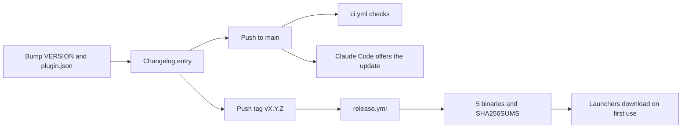

# Releasing a version

## In short

A release is a `v<version>` tag on a commit where `skills/codedocs/VERSION`,
`.claude-plugin/plugin.json` and the changelog agree. Pushing the tag runs the release workflow,
which checks that, builds the binaries for every platform, writes checksums and publishes a GitHub
release with the changelog entry as notes. Pushing the version bump to `main` is what makes Claude
Code offer the update to users.

## Step by step

### 1. Prepare

Set the version in `skills/codedocs/VERSION` and in `.claude-plugin/plugin.json`, and add a
`## <version> (<date>)` entry to `skills/codedocs/CHANGELOG.md` with each change tagged viewer,
content model, guidance or theme. If page guidance changed, bump
`skills/codedocs/reference/VERSION` too. `scripts/check-versions.sh` confirms they agree.

### 2. Push and tag

Push to `main` (CI runs on every push: `.github/workflows/ci.yml`), then push the tag. Pushing the
tag first and the bump to `main` after the release appears avoids a window where users can update
before the binaries exist.

### 3. The release workflow

`.github/workflows/release.yml` checks the launcher is executable in git, runs
`scripts/check-versions.sh` with the tag and repository name (so a wrong `skills/codedocs/REPO`
fails here instead of breaking installs), runs `build.sh dist`, extracts the changelog section for
the version, and publishes the release with `gh release create`.

## When it goes wrong

- A failed release leaves the tag pointing at a commit with no release. Fix, then move the tag
  (`git tag -f`, `git push -f origin <tag>`) or release the next patch version.
- Exit code 126 in CI means a script isn't executable. The workflows call scripts through `sh`,
  and the launcher's bit is checked explicitly.

## Things to know before changing it

Release asset names (`codedocs-<os>-<arch>`, `.exe` on Windows) are part of the launchers'
contract. Rename them and every installed version that hasn't updated yet can't download.
