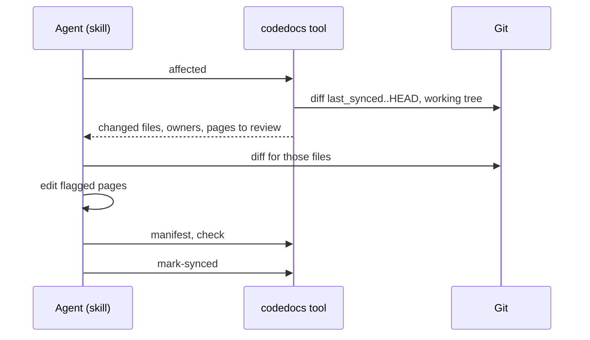

# Updating the docs after a change

## In short

The tool works out which pages a change touches from git and the components' `paths`, so the
agent never has to scan the docs or the code. The agent reads the diff for those files, makes
small edits to the flagged pages, records anything new (a decision, a gotcha, a term), runs the
checks and moves `last_synced` to `HEAD`. It should cost a fraction of an `init`.

## Step by step

### 1. What changed

`tool/cmds.go#cmdAffected` diffs from `last_synced` (or a range the user gives, such as
`main..feature`) to `HEAD`, and adds uncommitted and untracked files when no range was given. It
drops the docs folder and ignored files, assigns each file to the components whose `paths` match,
and flags pages that reference a changed file, involve a changed component, or own changed files.

### 2. Read only the change

The agent reads `git diff` for the flagged files, opening surrounding code only where the diff
doesn't explain itself.

### 3. Edit, minimally

`skills/codedocs/reference/update.md` asks for the smallest correct edit: fix what's now wrong,
add what's new, remove what's gone, keep wording that's still right. Locked pages are skipped and
reported. Insights and stated decisions are never edited; if the change contradicts one, the agent
asks the user.

### 4. Record what's new

A new dependency or a reversed approach gets a decision record; a new trap goes in gotchas; new
terms go in the glossary. Unclaimed files either extend a component's `paths` or become a proposed
new component, which the user approves first.

### 5. Finish

`manifest`, `check`, then `tool/cmds.go#cmdMarkSynced` moves the sync point to `HEAD`.

## When it goes wrong

- No `last_synced` and no range: `affected` stops and the agent asks which range to use.
- A renamed file shows as deleted plus unclaimed: refs to the old path fail `check`, which points
  at every line to fix.

## Things to know before changing it

Page selection is only as good as the components' `paths`. A file no component claims never
flags a component page, which is why `check` reports coverage and `affected` lists unclaimed files.
