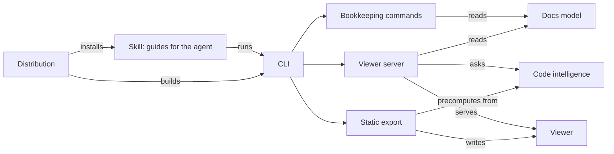

# codedocs

> [!NOTE]
> You're reading codedocs' documentation of itself, written by `/codedocs init` and published with
> `codedocs export`. Click any code reference to open the file beside the page; the code comes
> straight from GitHub at the commit these docs describe.

## What it does

codedocs writes documentation of a codebase for someone who didn't write it, and keeps it current.
A coding agent (Claude Code, or Codex, Cursor and others) follows the skill's instructions to read
the code and write layered pages: an overview, the components, the journeys through the code, the
patterns that cut across, the decisions behind it and the traps. A small executable does everything
mechanical: inventory, checking every reference still exists, working out which pages a change
affects, and serving a viewer where every code reference opens the real file.

> [!INSIGHT]
> codedocs exists for two problems: knowing that AI-written code is right, and keeping a mental
> model of a codebase you didn't write yourself. Docs that a person can read top-down, with every
> claim one click from the code it's about, address both.

## How it fits together



**[The skill](components/skill.md)** is markdown the agent follows: one guide per command, plus the
content model and writing guide every page follows. It does the thinking and writing.

**[CLI and shared helpers](components/cli.md)** is the Go executable's entry point, with the file
listing, git and glob helpers every command uses.

**[Docs model](components/docs-model.md)** reads a docs folder (config, pages, frontmatter, code
refs) and builds manifest.json, which everything else runs on.

**[Bookkeeping commands](components/commands.md)** answer the agent's mechanical questions:
`stats`, `check`, `affected`, `status` and friends.

**[Code intelligence](components/code-intelligence.md)** works out imports and definitions in
several languages with patterns, for the code panel and `find`.

**[Viewer server](components/server.md)** serves the viewer and a read-only code API on localhost.

**[Static export](components/export.md)** writes the docs as a static site whose code panel reads
source from GitHub. This page is one.

**[Viewer](components/viewer.md)** is the single-page app you're reading this in.

**[Distribution](components/distribution.md)** packages it all as a Claude Code plugin, builds
release binaries and downloads the right one on first run.

## Main journeys

- [Documenting a repo for the first time](flows/init.md): from `/codedocs init` to checked pages.
- [Updating the docs after a change](flows/update.md): the change mapped to pages, minimal edits.
- [Opening code from a page](flows/open-code.md): a click on a reference to the code at that line.
- [Installing and first run](flows/first-run.md): plugin install, then the binary download.
- [Releasing a version](flows/release.md): a tag to published binaries.
- [Publishing the docs as a static site](flows/publishing.md): how this site is built.

## Rules that always hold

- The agent never does what the tool can compute: listing files, mapping changes to pages,
  checking refs. See [agent and tool](concerns/agent-and-tool.md).
- Every code ref in the docs points at a real file, line or symbol; `codedocs check` fails
  otherwise (`tool/cmds.go#cmdCheck`).
- Links between pages are declared in one direction; the manifest computes the reverse
  (`tool/pages.go#buildManifest`).
- The user's insights and stated decisions survive every rewrite (`skills/codedocs/SKILL.md`).
- Viewer files in a docs folder are never edited by hand; themes are, and are never overwritten.
- The binary that runs is the one built for the skill's version, verified by checksum
  ([first run](flows/first-run.md)).
- Nothing listens beyond localhost, and the code panel is read-only
  ([security](concerns/security.md)).

## Running it

Use it: in Claude Code, `/plugin install codedocs --marketplace yowdendrift/codedocs`, then
`/codedocs init` in a repository.

Work on it (needs Go 1.22+):

```sh
./build.sh                       # binary for this machine, into skills/codedocs/bin
cd example
../skills/codedocs/bin/codedocs check
../skills/codedocs/bin/codedocs serve --open
```

On Windows, `.\build.ps1` and `.\install.ps1` (links the skill into `~/.claude/skills`). Releasing
is described in [releasing a version](flows/release.md) and `DEVELOPING.md`.

## Reading guide

- **To change how pages are written:** [the skill](components/skill.md), then
  `skills/codedocs/reference/content-model.md` and `skills/codedocs/reference/writing.md`. Bump
  the guidance version ([why](decisions/0003-separate-guidance-version.md)).
- **To change the viewer:** [viewer](components/viewer.md), and remember the static mode in
  [export](components/export.md).
- **To support a new language in the code panel:**
  [code intelligence](components/code-intelligence.md) and
  [the decision on patterns](decisions/0002-regex-code-intelligence.md).
- **To add a command:** [CLI](components/cli.md), then the
  [bookkeeping commands](components/commands.md) for the conventions, and a guide in the skill.
- **To ship it:** [distribution](components/distribution.md) and
  [releasing a version](flows/release.md).
- **Before anything:** [gotchas](gotchas.md).
