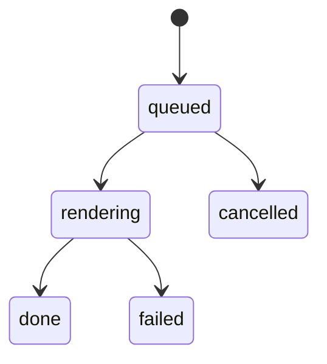

# Render pipeline

## Responsibility
Queueing, running and cancelling exports. It never touches the live timeline: it only sees the
snapshot it was given.

## How it works
`src/render/queue.ts#RenderQueue` keeps a list of jobs. When nothing is running it posts the next
queued job to a single worker, which reports progress and finally a result or an error.

## Parts
### Render queue
Runs on the UI thread. `enqueue` adds a job and starts it if idle; `pump` picks the next one;
`finish` frees the slot (`src/render/queue.ts#RenderQueue.pump`).

### Encode worker
Runs off the UI thread and does the slow work frame by frame (`src/render/encode.worker.ts`).
It checks for cancellation between frames.

## Interfaces
Messages to the worker: `render` and `cancel`. Messages back: `progress`, `done`, `error`.

## Watch out for
Cancelling a running job comes back as a **failed** job with the message "cancelled", not as
`cancelled` (inferred: probably an oversight, as the queue has a `cancelled` state it never uses
for running jobs).
