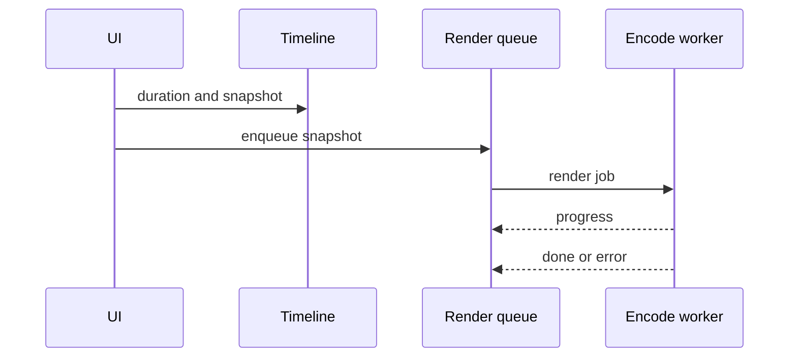

# Exporting a video

## In short
Pressing Export takes a snapshot of the timeline and queues it. The queue hands it to the encode
worker when it's free; the worker reports progress and then the finished file.

## Step by step
### 1. Press Export
`src/ui/export-button.ts#mountExportButton` checks the timeline isn't empty, then calls
`src/timeline/timeline.ts#Timeline.snapshot` so later edits can't affect the export.

### 2. Queue the job
`src/render/queue.ts#RenderQueue.enqueue` creates a job in state `queued` and calls `pump`.

### 3. Start rendering
`src/render/queue.ts#RenderQueue.pump` takes the first queued job if nothing is running, and
posts it to the worker.

### 4. Encode
`src/render/encode.worker.ts` encodes frame by frame, posting progress after each one.

### 5. Finish
On `done` or `error`, the queue records the result and calls `finish`, which starts the next job.

## When it goes wrong
Errors in the worker come back as `error` messages and mark the job `failed`. There is no retry.

## Things to know before changing it
The worker's `onmessage` handler is replaced for every job. That's only safe because jobs never
overlap; see [the one-worker decision](../decisions/0001-one-worker.md).
