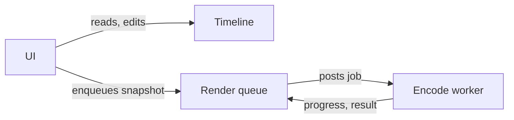

# Tiny Editor

## What it does
You place clips on tracks in a timeline and export the result as a video file. Exporting happens
in the background, so the editor stays responsive while it encodes.

## How it fits together

- The [timeline](components/timeline.md) is the document being edited: tracks of clips placed in time.
- The [render pipeline](components/render-pipeline.md) turns a copy of the timeline into a video
  file on a background worker, one job at a time.
- The [UI](components/ui.md) wires buttons to the other two.

## Main journeys
- [Exporting a video](flows/export.md): from pressing Export to a finished file.

## Topics
- [Exporting videos](topics/exporting.md): exporting from an admin's and a developer's point of view.

## Rules that always hold
- Render jobs work on a **snapshot** of the timeline, never the live one, so editing during an
  export can't corrupt it (`src/timeline/timeline.ts#Timeline.snapshot`).
- Only one job renders at a time; the rest wait in order (`src/render/queue.ts#RenderQueue.pump`).

## Running it
`npm run dev` starts the dev server; `npm test` runs the tests.

## Reading guide
- To change what gets exported, start at the [export flow](flows/export.md).
- To change how clips are stored, read the [timeline](components/timeline.md).
