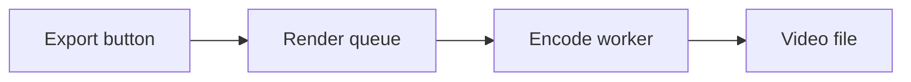

# Exporting videos

## What it does
Pressing **Export** turns everything on the timeline into one video file. The editor stays usable
while it works, and you can queue several exports; they run one after another.

## How it fits together

## What can go wrong
- **"Nothing to export"**: the timeline is empty. Add a clip first.
- **An export never finishes**: the encoder stopped without reporting back. Restart the editor;
  queued exports are lost, since the queue is held in memory only (inferred).
- **A cancelled export shows as failed**: expected for now; see [gotchas](../gotchas.md#a-cancelled-render-reports-as-failed).

> [!INSIGHT]
> Exports of more than about ten minutes are slow on laptops on battery power; plug in first.

## Under the hood
The journey is described step by step in [Exporting a video](../flows/export.md). The queue and
worker live in the [render pipeline](../components/render-pipeline.md), starting at
`src/render/queue.ts#RenderQueue`.

## Related
- [One long-lived encode worker](../decisions/0001-one-worker.md)
